# 👋 Hey, I'm Raoul Bock

### ERP Developer · Full Stack Engineer · Automation Builder · Aspiring AI Technologist

**Building software that connects business operations with modern technology.**

I'm a software developer from Namibia passionate about building practical solutions, automating workflows, and exploring new technologies.

- 💻 Building ERP integrations, WMS platforms, and business applications.
- 📦 Developing mobile and web solutions for real-world operations.
- 🤖 Exploring AI, intelligent automation, and emerging technologies.
- 🚀 Building towards something bigger through **Kalahari Labs**.
- 🌍 Always learning, experimenting, and building.

> *Build with purpose, learn without limits.*

---

## 🚀 Featured Projects

| Project | Description |
|---|---|
| 📦 **Pathlytixs** | Warehouse management and inventory platform with mobile scanning and ERP integrations. |
| 🚚 **Pathlytics** | Logistics tracking, delivery analytics, and interactive mapping. |
| 🖥️ **PulseDesk** | Desktop device monitoring and real-time system status dashboard. |
| 🌡️ **DC-ColdTrack** | Cold-chain monitoring and mobile temperature inspections. |
| 🧩 **TriviaStreak** | Full-stack quiz platform with user accounts and scoring. |
| 🌐 **GhostGate** | Lightweight tunneling and proxy utility for remote access. |

### ⚙️ Other Things I've Built
- Business Central integrations and automation.
- Automated sales order and pricing validation.
- Invoice processing and document automation.
- ERP automation using Selenium.
- Data extraction and reporting tools.

---

## 🛠️ Tech Stack

**Languages & Frontend**

**Backend & Database**

**Tools & Infrastructure**

**Also exploring:** React Native, Expo, Microsoft Dynamics 365 Business Central, AI, cybersecurity, and cloud infrastructure.

---

## 🧠 Beyond Development

I'm interested in more than just writing code.

- 🔐 Cybersecurity & Hack The Box
- 🐧 Linux & self-hosted infrastructure
- 🍓 Raspberry Pi & hardware projects
- 🐳 Docker & virtualization
- 🤖 Artificial Intelligence
- 🎮 Game development & experimentation

I believe the best way to learn technology is to build with it.

---

## 🏗️ Building Towards the Future

### Kalahari Labs

A technology initiative focused on creating practical software solutions for businesses.

Exploring opportunities in ERP integrations, business automation, warehouse management, analytics, and AI-powered applications.

---

## 📊 GitHub Contributions

<picture>
  <source media="(prefers-color-scheme: dark)" srcset="https://raw.githubusercontent.com/raoulbock/raoulbock/output/pacman-contribution-graph-dark.svg">
  <source media="(prefers-color-scheme: light)" srcset="https://raw.githubusercontent.com/raoulbock/raoulbock/output/pacman-contribution-graph.svg">
  
</picture>

---

## 📫 Let's Connect

---

  <b>Always building. Always exploring. Never standing still. 🚀</b>

